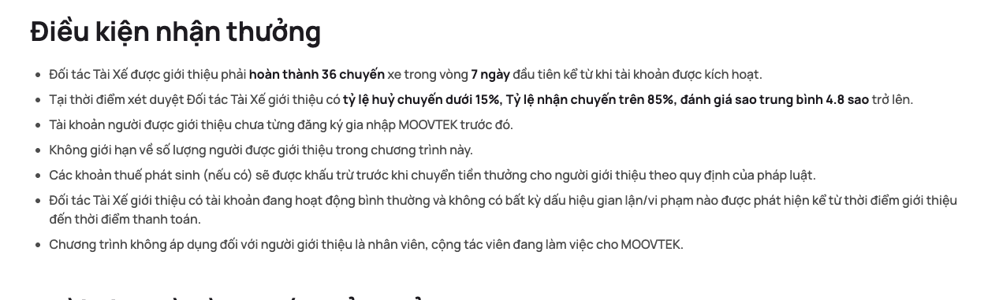
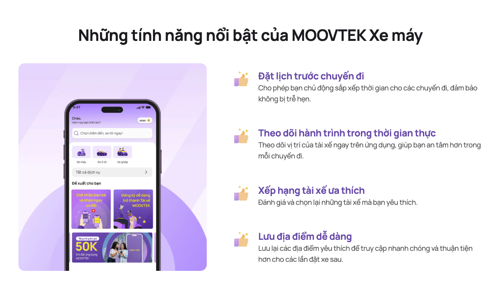
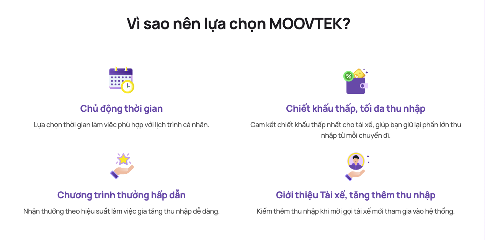
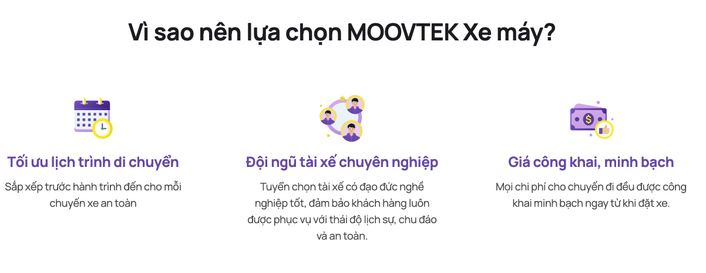
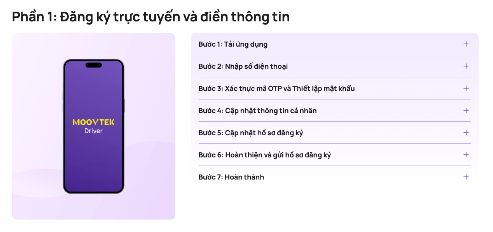

# Hướng dẫn thêm và cập nhật nội dung Moovtek CMS

**Dành cho:** nhân viên nội dung, marketing và người dùng không chuyên kỹ thuật.  
**Phạm vi:** các mục liên quan đến Blog, toàn bộ Single Type, các Collection Type còn lại và component dùng chung.  
**Đối chiếu cấu trúc nội dung:** ngày 15/10/2026, dự án dùng Strapi 5.16.0.

Bạn thao tác trên trang quản trị CMS bằng trình duyệt. Tài liệu giữ nguyên tên tiếng Anh của các mục và ô nhập liệu để bạn dễ tìm trên màn hình, kèm giải thích bằng tiếng Việt. Vị trí hoặc nhãn nút có thể khác tùy ngôn ngữ giao diện, quyền tài khoản và cấu hình của trang quản trị.

## Mục lục

1. [Bắt đầu và các nút thường dùng](#bat-dau)
2. [Blog: phạm vi và thứ tự thao tác](#blog)
3. [Tạo danh mục Category](#category)
4. [Tạo tác giả Author](#author)
5. [Tạo bài Blog và nhập nội dung](#tao-blog)
6. [Bài liên quan, phân nhóm và hiển thị Blog](#cau-hinh-blog)
7. [Sửa bài, tạm gỡ bài và kiểm tra](#quan-ly-blog)
8. [Single Type: cách thao tác](#single-type)
9. [Hướng dẫn từng Single Type](#tung-single-type)
10. [Collection Type: hướng dẫn các mục còn lại](#collection-type)
11. [Component dùng chung — Cách nhập và hình minh họa](#components)
12. [Checklist và xử lý vướng mắc](#kiem-tra)

Tra cứu nhanh: [component dùng chung](#components) · [các variant của ListWithItem và hình minh họa](#list-with-item-variants) · [ListWithTimeline](#component-list-with-timeline).

## 1. Bắt đầu và các nút thường dùng

### 1.1. Chuẩn bị trước khi nhập

- Địa chỉ trang quản trị và tài khoản được cấp bởi quản trị viên.
- Bản nội dung đã duyệt: tiêu đề, mô tả ngắn, nội dung chi tiết.
- Ảnh cần dùng; nên đặt tên dễ tìm, ví dụ `huong-dan-dat-xe-anh-dai-dien.jpg`.
- Đường dẫn đích của các nút bấm, nếu nội dung có nút hoặc liên kết.

Mở địa chỉ CMS được cấp, đăng nhập và chọn **Content Manager** ở thanh menu. Nếu không thấy mục cần sửa hoặc không có nút xuất bản, liên hệ quản trị viên để kiểm tra quyền tài khoản.

### 1.2. Nhận biết các nút và trạng thái

| Trên màn hình | Ý nghĩa |
| --- | --- |
| **Collection Types** | Nhóm có thể tạo nhiều nội dung, ví dụ nhiều bài Blog, nhiều Category. |
| **Single Types** | Nhóm chỉ có một nội dung cho mỗi mục, ví dụ Home hoặc Footer. |
| **Create new entry** | Tạo một nội dung mới trong Collection Type. |
| **Save** | Lưu bản nháp ở các mục có Draft & Publish; riêng Promotion, lưu trực tiếp nội dung. |
| **Publish** | Xuất bản nội dung đã nhập. |
| **Draft** | Bản nháp; chọn tab này để nhập hoặc sửa. |
| **Published** | Bản đã xuất bản; tab này dùng để xem nội dung đã công bố. |
| **Modified** | Có chỉnh sửa đã lưu nhưng chưa xuất bản lại. |
| **Unpublish** | Gỡ bản đã xuất bản, giữ nội dung để xử lý tiếp. |
| **TRUE / FALSE** | Bật / tắt một lựa chọn. |

**Quy trình dùng hằng ngày:** nhập hoặc sửa → **Save** → kiểm tra → **Publish** → mở website kiểm tra. Sau khi sửa bài đã xuất bản, cần Publish lại để đưa thay đổi lên bản công bố. Tham khảo thao tác lưu và xuất bản trong [hướng dẫn Draft & Publish của Strapi](https://docs.strapi.io/cms/features/draft-and-publish).

**Riêng Promotion:** mục này không bật Draft & Publish, nên không có bước Publish. Khi chuẩn bị nội dung mới, giữ `isShow = FALSE`, nhập và Save; khi sẵn sàng hiển thị, bật `isShow = TRUE` rồi Save. Xem [hướng dẫn Promotion](#promotion) trước khi thao tác.

Các trường đánh dấu `*` cần được điền khi xuất bản; với mục không có Draft & Publish như Promotion, cần điền khi lưu. Trong tài liệu, **bắt buộc** là yêu cầu của CMS; **khuyến nghị** là nội dung nên có để bài hoặc trang đầy đủ.

### 1.3. Chọn hoặc tải ảnh lên

1. Bấm vào ô ảnh, ví dụ `thumbnail` hoặc `image`.
2. Chọn ảnh đã có trong **Media Library**. Nếu ảnh chưa có, chọn **Add more assets** hoặc nút thêm tệp tương ứng, rồi tải ảnh từ máy tính.
3. Chờ tải xong, chọn ảnh và xác nhận đưa ảnh vào ô nhập liệu.
4. Kiểm tra hình thu nhỏ để chắc chắn đã chọn đúng ảnh.

Nếu có ô **Alternative text**, nhập mô tả ngắn về ảnh, ví dụ “Tài xế Moovtek hướng dẫn khách đặt xe”. Có thể xem thêm cách quản lý ảnh trong [hướng dẫn Media Library của Strapi](https://docs.strapi.io/cms/features/media-library).

Nên dùng ảnh rõ nét, đúng bố cục của vị trí cần đặt. Khi thay ảnh, tải ảnh mới và chọn lại trong nội dung; việc bỏ ảnh khỏi một ô nhập liệu khác với xóa tệp khỏi Media Library. Ảnh trong thư viện có thể đang được nhiều bài hoặc trang sử dụng.

## 2. Blog: phạm vi và thứ tự thao tác

| Mục cần thao tác | Dùng để làm gì? | Khi nào cần dùng? |
| --- | --- | --- |
| **Category** | Danh mục bài viết. | Tạo hoặc chọn nhóm cho bài, ví dụ “Tin tức Moovtek”. |
| **Author** | Thông tin tác giả. | Tạo hoặc chọn người đứng tên bài viết. |
| **Blog** | Bài viết, ảnh đại diện và nội dung chi tiết. | Thêm bài mới hoặc cập nhật bài cũ. |
| **Media Library** | Nơi lưu ảnh và các tệp được sử dụng trong nội dung. | Chọn ảnh đại diện, banner và ảnh minh họa. |
| **Home → centralArticleSection** | Thiết lập mục bài viết ở trang chủ. | Chọn danh mục có bài muốn đưa lên trang chủ. |

**Thứ tự nên làm khi viết bài đầu tiên:** Category → Author → Blog → kiểm tra Home nếu cần đưa bài lên trang chủ.

Nếu Category hoặc Author đã có, chọn nội dung có sẵn để tránh tạo trùng. `tags`, `relatedSection`, `metadata` và `contentBlocks` là các phần nằm trong form Blog, không phải các mục cần tạo riêng trong menu.

Nếu form có lựa chọn ngôn ngữ (**Locale**), chọn đúng ngôn ngữ trước khi nhập. Blog và Category có cấu hình nội dung theo ngôn ngữ; mỗi bản ngôn ngữ cần được kiểm tra và xuất bản riêng khi hệ thống sử dụng tính năng này. Nếu không có bộ chọn ngôn ngữ, tiếp tục với form hiện tại.

## 3. Tạo danh mục Category

**Đường dẫn thao tác:** Content Manager → Collection Types → **Category** → **Create new entry**.

| Trường | Cách nhập | Yêu cầu |
| --- | --- | --- |
| `name` | Tên danh mục dễ hiểu, ví dụ “Tin tức Moovtek”. | Bắt buộc. |
| `slug` | Phần tên dùng trong đường dẫn, ví dụ `tin-tuc-moovtek`. Có thể sinh từ `name`; kiểm tra lại trước khi lưu. | Bắt buộc, không trùng. |
| `isActive` | Chọn TRUE để danh mục hoạt động. | Khuyến nghị bật khi sử dụng. |
| `blogs` | Danh sách bài thuộc danh mục. Khi tạo bài, chọn `category` ngay trong Blog để gắn bài vào đây. | Không cần chọn khi tạo danh mục mới. |

1. Nhập `name` và kiểm tra `slug`.
2. Bật `isActive`.
3. Bấm **Save**, sau đó **Publish**.

Kết quả mong đợi: danh mục xuất hiện để lựa chọn trong ô `category` của Blog. Muốn sử dụng danh mục trong mục bài viết ở Home, danh mục cần được xuất bản và bật `isActive`.

**Cách viết slug:** chữ thường, không dấu, dùng dấu gạch ngang giữa các từ. Tránh đổi slug sau khi đường dẫn đã được chia sẻ; nếu cần đổi, thông báo người phụ trách website để xử lý các liên kết cũ.

## 4. Tạo tác giả Author

**Đường dẫn thao tác:** Content Manager → Collection Types → **Author** → **Create new entry**.

| Trường | Cách nhập |
| --- | --- |
| `name` | Tên tác giả, ví dụ “Ban biên tập Moovtek”. |
| `avatar` | Chọn ảnh đại diện tác giả. |
| `email` | Địa chỉ email đúng định dạng, nếu cần lưu. |
| `isActive` | Chọn TRUE khi tác giả đang được sử dụng. |
| `blogs` | Trường liên kết bài viết trên form Author. Thao tác chọn tác giả cho bài thực hiện tại ô `author` của Blog. |

1. Điền tên; thêm ảnh và email nếu có.
2. Bật `isActive`.
3. Bấm **Save** → **Publish**.

Các trường của Author hiện không được đánh dấu bắt buộc trong cấu trúc CMS, nhưng nên có tên để dễ tìm khi chọn tác giả.

**Lưu ý khi chọn tác giả:** quan hệ `author` trong Blog hiện được cấu hình một-một. Nếu CMS cảnh báo tác giả đã gắn với bài khác, liên hệ quản trị viên để kiểm tra trước khi chuyển liên kết. Cách hiển thị tên và ảnh tác giả trên website phụ thuộc giao diện đang sử dụng.

## 5. Tạo bài Blog và nhập nội dung

### 5.1. Tạo bài mới

**Đường dẫn thao tác:** Content Manager → Collection Types → **Blog** → **Create new entry**.

| Trường | Ý nghĩa và cách nhập | Yêu cầu |
| --- | --- | --- |
| `title` | Tiêu đề bài, ví dụ “Hướng dẫn đặt xe Moovtek”. | Bắt buộc. |
| `slug` | Tên đường dẫn, ví dụ `huong-dan-dat-xe-moovtek`. Có thể sinh từ `title`; kiểm tra tính dễ đọc và không trùng. | Bắt buộc. |
| `description` | Mô tả ngắn tóm tắt nội dung bài. Nên viết 1–3 câu, không chép toàn bộ nội dung chi tiết vào đây. | Bắt buộc. |
| `postedAt` | Ngày hiển thị của bài viết. Chọn bằng lịch trên form. | Bắt buộc. |
| `thumbnail` | Ảnh đại diện của bài trong danh sách. | Khuyến nghị dùng ảnh. |
| `category` | Chọn một danh mục đã tạo và xuất bản. | Khuyến nghị. |
| `author` | Chọn tác giả phù hợp. | Theo quy trình biên tập. |
| `tags` | Các nhãn ngắn, mỗi nhãn nhập trong ô `value`, ví dụ `Đặt xe`. | Tùy chọn. |
| `contentBlocks` | Các khối tạo nên nội dung chi tiết; xem mục 5.2. | Khuyến nghị có ít nhất một khối nội dung. |
| `relatedSection` | Cấu hình bài liên quan; xem mục 6.1. | Tùy chọn. |
| `metadata` | Phân nhóm và mức ưu tiên nội bộ; xem mục 6.2. | Tùy chọn. |
| `isActive` | Bật TRUE để bài được cung cấp qua chức năng xem chi tiết theo đường dẫn. | Cần bật cho bài muốn hiển thị. |
| `isHome` | Đánh dấu bài được đưa vào nhóm bài viết của trang chủ. | Bật khi cần xuất hiện ở Home. |
| `isAllowShare` | Cờ cho phép giao diện hiển thị tính năng chia sẻ. | Bật khi cần. |
| `isShowContactUsSection` | Cờ cho phép giao diện hiển thị phần liên hệ. | Bật khi cần. |

`postedAt` là ngày nội dung, **không tự hẹn giờ xuất bản**. Ngày tương lai không thay thế việc quản lý bản nháp: khi chưa muốn công bố, lưu bằng Save và chưa bấm Publish.

`isAllowShare` và `isShowContactUsSection` cần được giao diện website hỗ trợ. Sau khi bật, kiểm tra website để xác nhận tính năng xuất hiện.

**Thêm tag:** mở `tags` → thêm phần tử → nhập `value` bắt buộc → thêm phần tử tiếp theo nếu cần. Trường `value` được cấu hình không trùng; xem mục xử lý vướng mắc nếu CMS từ chối nhãn đã dùng.

### 5.2. Nhập nội dung chi tiết bằng contentBlocks

`contentBlocks` là danh sách các khối nội dung. Bạn có thể thêm nhiều khối và sắp xếp theo thứ tự đọc. Cách thêm nhóm trường và chọn nội dung liên kết được mô tả trong [hướng dẫn Content Manager của Strapi](https://docs.strapi.io/cms/features/content-manager).

1. Tìm `contentBlocks`, bấm nút thêm khối hoặc dấu **+**.
2. Chọn loại khối trong danh sách bên dưới.
3. Nhập các ô của khối vừa thêm.
4. Thêm khối tiếp theo nếu cần. Dùng tay nắm kéo hoặc nút di chuyển của khối để đổi vị trí.

| Tên khối trong CMS | Dùng khi nào? | Những ô cần chú ý |
| --- | --- | --- |
| **RichTextBlock** | Nhập nội dung bài thông thường: đoạn văn, đề mục, danh sách, liên kết. | `content` bắt buộc. |
| **Banner** | Đặt ảnh lớn cùng tiêu đề hoặc mô tả. | `title`, `description`, `image`, `subImage`; `image` bắt buộc khi thêm khối. |
| **CtaSection** | Mời người đọc thực hiện hành động, ví dụ đăng ký hoặc liên hệ. | `eyebrow`, `title`, `description`, `image`, `buttons`, `items`, `imagePosition`. |
| **ContentListMediaSection** | Trình bày nội dung dạng danh sách kèm ảnh máy tính và điện thoại. | `title` bắt buộc; `description`, `desktopImage`, `mobileImages`, `listTitle`, `items` và lựa chọn bố cục. |
| **ListWithItem** | Danh sách lợi ích, điều kiện hoặc hướng dẫn. | `title` bắt buộc; `description`, `image`, `items`, `sectionKey`, `variant`. |
| **ListWithTimeline** | Các bước theo trình tự. | `title` bắt buộc; `description`, `image`, `timelines`, `buttons`, `variant`. |

**Cách nhanh nhất cho bài chủ yếu là văn bản:** thêm **RichTextBlock** → nhập `content` → thêm ảnh bằng **Banner** nếu cần.

Trong `content`, thao tác tương tự trình soạn thảo văn bản: nhập nội dung, bôi đen đoạn cần định dạng, rồi chọn tiêu đề phụ, chữ đậm, danh sách hoặc liên kết trên thanh công cụ. Nên chia thành đoạn ngắn; khi dán từ Word hoặc nguồn khác, kiểm tra lại định dạng. Chỉ dùng chức năng có trên thanh công cụ của trình soạn thảo hiện tại.

Các danh sách `items`, các bước `timelines` và nút `buttons` được giải thích tại [Component dùng chung](#components). Nếu thêm nhầm một khối, dùng nút xóa của chính khối đó và kiểm tra lại các phần còn lại trước khi lưu.

### 5.3. Ví dụ một bài hoàn chỉnh

Ví dụ này dùng nội dung minh họa; thay bằng nội dung đã duyệt khi thao tác thực tế.

| Trường | Nội dung mẫu |
| --- | --- |
| `title` | Hướng dẫn đặt xe Moovtek |
| `slug` | `huong-dan-dat-xe-moovtek` |
| `description` | Các bước cơ bản giúp bạn đặt chuyến xe trên ứng dụng Moovtek. |
| `postedAt` | Ngày công bố nội dung đã thống nhất với người duyệt. |
| `thumbnail` | Ảnh minh họa hướng dẫn đặt xe. |
| `category` | Chọn danh mục hướng dẫn đã xuất bản. |
| `author` | Chọn tác giả đã được xác nhận phù hợp. |
| `contentBlocks` | Thêm RichTextBlock và nhập nội dung hướng dẫn đã duyệt. |
| `isActive` | TRUE. |
| `isHome` | TRUE nếu cần đưa lên trang chủ; FALSE nếu không. |

1. Điền các trường theo bảng.
2. Kiểm tra nội dung của RichTextBlock, ảnh và liên kết.
3. Bấm **Save**.
4. Khi bài đã được duyệt, bấm **Publish** và hoàn tất hộp xác nhận nếu có.
5. Mở website, tìm bài trong danh sách và kiểm tra trang chi tiết.

## 6. Bài liên quan, phân nhóm và hiển thị Blog

### 6.1. Chọn bài liên quan trong relatedSection

Thêm hoặc mở `relatedSection`, rồi chọn cách lấy bài:

| Trường | Cách nhập |
| --- | --- |
| `source` | **MANUAL**: tự chọn bài. **AUTO**: lấy bài tự động trong cùng Category. |
| `limit` | Số bài muốn hiển thị, ví dụ `3`. Chức năng hiện tại dùng mặc định 3 nếu không nhập số dương hợp lệ, tối đa 20; giao diện có thể giới hạn số lượng thêm. |
| `blogs` | Dùng khi chọn MANUAL: tìm và chọn các bài liên quan đã xuất bản, bật `isActive`. |

**Nếu muốn tự chọn:** chọn MANUAL → thêm bài vào `blogs` → đặt `limit` → Save → Publish lại bài đang sửa.

**Nếu muốn lấy tự động:** chọn AUTO → đặt `limit` → bảo đảm bài đang sửa có Category và danh mục đó có các bài khác đã xuất bản, bật `isActive` → Save → Publish.

Chức năng bài liên quan loại trừ chính bài đang xem. Với AUTO, bài có `metadata.priority` cao hơn được ưu tiên; nếu cùng ưu tiên, bài có `postedAt` mới hơn được chọn trước. Nếu không có bài phù hợp, danh sách có thể trống. Danh sách `blogs` chọn tay chỉ dùng khi `source` là MANUAL.

### 6.2. Phân nhóm nội bộ trong metadata

| Trường | Ý nghĩa |
| --- | --- |
| `topic` | Nhóm nội dung: **DRIVER** = tài xế; **PASSENGER** = hành khách; **MOOVTEK** = thương hiệu/doanh nghiệp. Chọn theo quy ước biên tập. |
| `priority` | Mức ưu tiên khi chọn bài liên quan tự động. Mặc định `0`; số lớn hơn được ưu tiên hơn. |

`metadata` là nhóm thông tin nội bộ. Chọn `topic` không thay cho việc chọn `category`, và tăng `priority` không tự đưa bài lên trang chủ.

### 6.3. Đưa bài lên trang chủ

Để bài đủ điều kiện xuất hiện trong mục bài viết của Home:

1. Trong Blog, chọn Category, bật `isActive` và `isHome`, rồi **Save → Publish**.
2. Trong Category được chọn, bật `isActive` và **Publish**.
3. Mở **Single Types → Home → centralArticleSection**.
4. Trong `categories`, chọn đúng Category của bài; đặt tiêu đề và số lượng bài tại `articleLimit` nếu cần.
5. **Save → Publish** Home, rồi kiểm tra trang chủ.

Bài trong mỗi danh mục được chức năng Home sắp theo `postedAt` từ mới đến cũ. Số bài thực tế trên màn hình còn phụ thuộc cách giao diện dùng `articleLimit` và bố cục trang chủ.

## 7. Sửa bài, tạm gỡ bài và kiểm tra

### 7.1. Sửa bài đã có

1. Vào **Content Manager → Blog**.
2. Tìm theo tiêu đề; nếu danh sách hỗ trợ, dùng tìm kiếm hoặc bộ lọc.
3. Mở bài và chọn tab **Draft**.
4. Sửa phần cần cập nhật; hạn chế đổi `slug` của bài đã được chia sẻ.
5. Bấm **Save**, kiểm tra lại, rồi **Publish**.
6. Tải lại trang bài viết trên website để kiểm tra bản mới.

### 7.2. Tạm gỡ bài

Mở bài, vào menu hành động của nội dung, chọn **Unpublish** và xác nhận. Nếu có lựa chọn giữ bản nháp, chọn phương án phù hợp với nội dung cần giữ. Khi muốn đăng lại, kiểm tra bản nháp và bấm **Publish**. Thao tác này được mô tả trong [hướng dẫn gỡ xuất bản của Strapi](https://docs.strapi.io/cms/features/draft-and-publish).

Riêng Blog, đặt `isActive` thành FALSE rồi Save và Publish lại cũng khiến bài không được lấy qua chức năng xem chi tiết theo slug và chọn bài liên quan hiện tại. Để gỡ bản công bố của bài, dùng Unpublish. Sau mỗi thao tác, kiểm tra trên website vì trang đang mở có thể còn nội dung cũ.

## 8. Single Type: cách thao tác

Single Type là nội dung duy nhất của một trang hoặc một khu vực dùng chung. Ví dụ: **Home** quản lý trang chủ; **Navbar** quản lý thanh menu; **SiteConfig** quản lý thông tin doanh nghiệp và các liên kết ứng dụng.

### 8.1. Quy trình chung

1. Vào **Content Manager → Single Types**.
2. Chọn mục cần chỉnh sửa theo [bảng ở mục 9](#tung-single-type).
3. Nếu chưa có nội dung, nhập vào form đang mở. Nếu đã có, chọn **Draft** để sửa.
4. Mở nhóm cần nhập, hoặc bấm dấu **+** để thêm nhóm nếu chưa có.
5. Điền các trường; thêm phần tử cho danh sách nếu cần.
6. Bấm **Save**, kiểm tra và **Publish**.
7. Mở trang hoặc khu vực tương ứng trên website để kiểm tra.

Bạn bổ sung nội dung trong Single Type hiện có. Ví dụ thêm một bước hướng dẫn vào trang đăng ký, hoặc thêm một mục menu vào Navbar.

Cách nhập các nhóm như Banner, Item, ListWithItem và ListWithTimeline được giải thích tại [Component dùng chung](#components).

## 9. Hướng dẫn từng Single Type

Danh sách hiện tại có **13 Single Type**. Chọn đúng tên ở cột đầu trong **Content Manager → Single Types**.

| Tên trong CMS | Nội dung quản lý |
| --- | --- |
| [Home](#home) | Trang chủ. |
| [Navbar](#navbar) | Logo, menu và nút ở thanh điều hướng. |
| [Footer](#footer) | Logo và các nhóm nội dung ở chân trang. |
| [SiteConfig](#site-config) | Thông tin doanh nghiệp, liên hệ, liên kết ứng dụng và mạng xã hội. |
| [Contact](#contact) | Trang liên hệ và nội dung biểu mẫu. |
| [Support](#support) | Trang hỗ trợ. |
| [Policy](#policy) | Trang quyền lợi và trách nhiệm/chính sách. |
| [Driver](#driver) | Trang dành cho tài xế đối tác. |
| [DriverRegistrationProcess](#driver-registration-process) | Quy trình đăng ký tài xế. |
| [DriverIntroducing](#driver-introducing) | Nội dung giới thiệu tài xế đối tác. |
| [IntroduceFriend](#introduce-friend) | Chương trình giới thiệu bạn bè. |
| [DriverTopUpZaloPayInstruction](#driver-top-up) | Hướng dẫn tài xế nạp tiền qua ZaloPay. |
| [DriverWithdrawalIntruction](#driver-withdrawal) | Hướng dẫn tài xế rút tiền. Tên trong CMS hiện viết là `Intruction`. |

Các trường `publishedDate` ở những trang bên dưới là ngày nội dung; không tự hẹn giờ xuất bản. Khi đã nhập xong một trang, luôn thực hiện **Save → Publish → kiểm tra website**.

### 9.1. Home — Trang chủ

| Nhóm | Nội dung cần nhập |
| --- | --- |
| `heroSection` | Mở `banner` để nhập banner máy tính; mở `mobileBanner` để nhập banner điện thoại. Mỗi Banner đã thêm cần có `image`. |
| `ourServiceSection` | `eyebrow`, `title`, `description` đều bắt buộc khi thêm nhóm. Trong `services`, chọn các dịch vụ đã có. |
| `benefitsOfDownloadingSection` | `eyebrow`, `title` bắt buộc; thêm `description`, `image` và các lợi ích trong `items`. |
| `applicationRegistrationSection` | `eyebrow`, `title` bắt buộc; thêm `description`, `image` và các bước trong `timelines`. |
| `centralArticleSection` | `title` bắt buộc; `eyebrow` tùy chọn; chọn `categories`, đặt `articleLimit` là số nguyên dương. Giá trị mặc định là `4`. |
| `driverRegistrationSection` | `title` bắt buộc; thêm `eyebrow`, `image` và nội dung đăng ký tài xế trong `items`. |

**Ví dụ thêm một lợi ích khi tải ứng dụng:** mở `benefitsOfDownloadingSection` → tìm `items` → thêm phần tử → nhập `title`, `description` và ảnh/biểu tượng nếu cần → Save → Publish.

**Nếu muốn thay bài ở trang chủ:** làm theo [mục 6.3](#cau-hinh-blog), sau đó kiểm tra `centralArticleSection` của Home.

`Service` hiện thuộc **Collection Types**. Nếu chưa có dịch vụ để chọn trong `ourServiceSection.services`, tạo tại Collection Types → Service: nhập `title`, `description`, `url`, `slug` và `banner` có `image` (các trường bắt buộc); thêm `thumbnail` nếu có; bật `isActive`, Save và Publish. Chức năng Home hiện chỉ lấy các dịch vụ đã xuất bản và đang hoạt động.

Xem thêm [hướng dẫn Service](#service) để nhập đầy đủ nội dung chi tiết của dịch vụ.

### 9.2. Navbar — Thanh menu

**Các phần bắt buộc:** `logo`, ít nhất **1** phần tử trong `items`, và **1–2** phần tử trong `buttons`.

| Trường | Cách thao tác |
| --- | --- |
| `logo` | Chọn logo dùng trên thanh menu. |
| `items` | Thêm một phần tử cho mỗi mục menu; xem bảng bên dưới. |
| `buttons` | Thêm nút theo [hướng dẫn Button](#component-button), nhập `label` bắt buộc và chọn hành động phù hợp. |

Trong mỗi phần tử `items`:

| Trường | Cách nhập |
| --- | --- |
| `label` | Chữ trên menu, ví dụ “Trang chủ”; bắt buộc. |
| `linkType` | INTERNAL_URL = trang trong website; EXTERNAL_URL = trang bên ngoài; DROPDOWN = menu có các mục con. Bắt buộc. |
| `link` | Đường dẫn đã có. Với INTERNAL_URL có thể dùng `/`; với EXTERNAL_URL dùng địa chỉ đầy đủ. |
| `icon` | Biểu tượng nếu thiết kế có sử dụng. |
| `order` | Thứ tự hiển thị: số nhỏ đứng trước số lớn. Nên dùng `10`, `20`, `30` để dễ chèn thêm. Mặc định là `999`. |
| `isActive` | TRUE để hiển thị mục menu qua chức năng lấy menu đang hoạt động. |
| `children` | Các mục con khi chọn DROPDOWN. |

Mỗi phần tử `children` có `label` **bắt buộc**, `link`, `icon`, `linkType`, `order`, `isActive`. `linkType` của mục con chỉ chọn INTERNAL_URL hoặc EXTERNAL_URL.

**Ví dụ thêm liên kết Trang chủ:** thêm một phần tử `items` → `label = Trang chủ` → `linkType = INTERNAL_URL` → `link = /` → đặt `order` → bật `isActive` → Save → Publish.

Kiểm tra menu trên máy tính và điện thoại; với DROPDOWN, thử mở menu con và bấm từng liên kết. Thứ tự menu được chức năng hiện tại lấy theo `order`, nên cần cập nhật số này khi đổi vị trí.

### 9.3. Footer — Chân trang

| Trường | Nội dung cần nhập |
| --- | --- |
| `logo` | Logo ở chân trang. |
| `aboutInfo` | Nhóm giới thiệu: nhập `title` và thêm nội dung/liên kết trong `items`. |
| `supportInfo` | Nhóm hỗ trợ: nhập `title` và các `items`. |
| `businessInfo` | Nhóm thông tin doanh nghiệp: nhập `title` và các `items`. |

Ba nhóm đều dùng **ListWithItem**. Khi thêm nhóm cần có `title`; khi thêm mỗi Item cần có `title`. Nếu mục dẫn sang trang khác, nhập `link` và `actionType` phù hợp.

**Ví dụ cập nhật một liên kết hỗ trợ:** mở `supportInfo.items` → chọn mục cần sửa → cập nhật tiêu đề hoặc đường dẫn → Save → Publish → cuộn xuống chân website và bấm thử liên kết.

### 9.4. SiteConfig — Thông tin chung của website

Mở đúng nhóm sau để cập nhật:

| Nhóm | Chức năng |
| --- | --- |
| `companyInfo` | Tên, địa chỉ và thông tin pháp lý của doanh nghiệp. |
| `contactInfo` | Hotline và email hỗ trợ. |
| `appLinks` | Liên kết tải ứng dụng theo nền tảng, kèm mã QR nếu có. |
| `socialLinks` | Các kênh mạng xã hội. |

**companyInfo:** điền theo thông tin doanh nghiệp đã được xác nhận.

| Trường | Nội dung |
| --- | --- |
| `name` | Tên doanh nghiệp. |
| `headOffice` | Địa chỉ trụ sở chính. |
| `representativeOffice` | Địa chỉ văn phòng đại diện. |
| `businessRegistrationNumber` | Số đăng ký kinh doanh. |
| `businessRegistrationDate` | Ngày đăng ký kinh doanh. |
| `businessRegistrationPlace` | Nơi đăng ký/cấp đăng ký kinh doanh. |
| `transportBusinessLicenseNumber` | Số giấy phép kinh doanh vận tải. |
| `transportBusinessLicenseDate` | Ngày cấp giấy phép kinh doanh vận tải. |
| `transportBusinessLicensePlace` | Nơi cấp giấy phép kinh doanh vận tải. |
| `legalRepresentative` | Người đại diện pháp luật. |

Các trường ngày trong nhóm này là ô văn bản; nhập theo định dạng đang dùng trên website, ví dụ `14/10/2026`. Giữ số điện thoại và số giấy tờ đầy đủ, kể cả số `0` ở đầu.

**contactInfo:** nhập số hotline vào `hotline` và email hỗ trợ vào `supportEmail`.

**appLinks:** thêm một phần tử cho nền tảng cần dùng:

1. Chọn `platform`: IOS hoặc ANDROID.
2. Nhập `url` tải ứng dụng và chọn `icon` nếu có.
3. Trong `apps`, thêm mã QR: chọn `type` DRIVER (tài xế) hoặc PASSENGER (hành khách), chọn `qrImage`, nhập `url` tương ứng.
4. Sau khi xuất bản, bấm liên kết và quét QR bằng điện thoại để kiểm tra đúng ứng dụng.

**socialLinks:** mỗi phần tử gồm `platform` (FACEBOOK, YOUTUBE, TIKTOK, ZALO hoặc LINKEDIN), `url` và `icon`. Nhập địa chỉ chính thức của doanh nghiệp, rồi bấm thử sau khi xuất bản.

### 9.5. Contact — Trang liên hệ

| Nhóm | Nội dung cần nhập |
| --- | --- |
| `configuration` | Thông tin trang và SEO theo [hướng dẫn PageConfiguration](#component-page-configuration). |
| `banner` | Tiêu đề, mô tả và ảnh banner. |
| `form` | Tiêu đề, mô tả, các ô nhập và nút gửi của biểu mẫu. |

Trong `form`, nhập `title`, `description`, rồi thêm từng phần tử `inputs`:

| Trường của một Input | Cách nhập |
| --- | --- |
| `label` | Tên ô trên biểu mẫu, ví dụ “Họ và tên”; bắt buộc. |
| `placeholder` | Gợi ý trong ô, ví dụ “Nhập họ và tên của bạn”. |
| `required` | TRUE nếu muốn giao diện yêu cầu người dùng điền ô này; mặc định TRUE. |

Trong `submitButton`, nhập `label` **bắt buộc**, ví dụ “Gửi thông tin”, và giữ hành động theo cấu hình biểu mẫu hiện có.

Các ô trên quản lý nội dung của biểu mẫu. Việc gửi thông tin đến nơi nào do chức năng website quyết định. Nếu thêm ô mới hoặc đổi hành động nút gửi, cần người phụ trách website xác nhận chức năng tiếp nhận hỗ trợ thay đổi đó. Hotline/email dùng chung được cập nhật tại **SiteConfig → contactInfo**.

### 9.6. Support — Trang hỗ trợ

| Trường | Nội dung cần nhập |
| --- | --- |
| `configuration` | Thông tin trang và SEO. |
| `banner` | Banner trang hỗ trợ. |
| `items` | Danh sách chủ đề hoặc nội dung hỗ trợ. Mỗi mục dùng [Item](#component-item). |

**Để thêm một nội dung hỗ trợ:** thêm phần tử vào `items` → nhập `title` bắt buộc → thêm mô tả, nội dung chi tiết hoặc liên kết → Save → Publish.

Nếu cần mục có thể mở/thu gọn, dùng `variant = COLLAPSE` khi giao diện đang hỗ trợ kiểu này, rồi kiểm tra thao tác mở mục trên website.

### 9.7. Policy — Trang quyền lợi và trách nhiệm

| Trường | Nội dung cần nhập |
| --- | --- |
| `configuration` | Thông tin trang và SEO. |
| `banner` | Banner của trang. |
| `benefitAndResponsibilitySection` | Nhóm quyền lợi và trách nhiệm, dùng ListWithItem: nhập `title` bắt buộc, mô tả và các `items`. |

Thêm mỗi quyền lợi hoặc trách nhiệm thành một Item riêng nếu bố cục hiện tại trình bày theo danh sách. Dùng bản nội dung đã được người phụ trách duyệt trước khi Publish.

### 9.8. Driver — Trang tài xế đối tác

| Trường | Nội dung cần nhập |
| --- | --- |
| `configuration` | Thông tin trang và SEO. |
| `banner` | Banner đầu trang. |
| `whyChooseUsSection` | Lý do lựa chọn Moovtek, dùng ListWithItem. |
| `driverPartnerProcedureSection` | Quy trình trở thành đối tác, dùng ListWithTimeline; nhập `order` và `title` cho từng bước. |
| `ctaSection` | Lời mời đăng ký, ảnh, nút bấm và các mục bổ sung nếu cần. |
| `isShowCTASection` | Bật TRUE để yêu cầu giao diện hiển thị phần CTA; mặc định FALSE. |

**Ví dụ bổ sung một bước đăng ký:** mở `driverPartnerProcedureSection.timelines` → thêm bước → nhập `order`, `title`, `description` → Save → Publish. Kiểm tra bước mới nằm đúng vị trí.

Khi dùng CTA, điền nội dung trong `ctaSection`, bật `isShowCTASection` và bấm thử nút đăng ký trên website.

### 9.9. DriverRegistrationProcess — Quy trình đăng ký tài xế

| Trường | Nội dung cần nhập |
| --- | --- |
| `configuration` | Thông tin trang và SEO. |
| `title`, `description`, `publishedDate` | Tiêu đề, mô tả ngắn và ngày của nội dung. |
| `banner` | Banner trang quy trình. |
| `bannerConfigurations` | Các nhãn/ảnh gắn với `key` hiện có; cách nhập tại [hướng dẫn Config](#component-config). |
| `onlineRegistrationSection` | Hướng dẫn đăng ký trực tuyến, dùng ListWithItem. |
| `examIntroducingSection` | Nội dung giới thiệu phần kiểm tra/thi, dùng ListWithItem. |

Để bổ sung hướng dẫn đăng ký, mở `onlineRegistrationSection.items`, thêm hoặc sửa từng mục. Nhập đủ tên bước và hướng dẫn để người đọc có thể thực hiện theo thứ tự.

### 9.10. DriverIntroducing — Nội dung giới thiệu tài xế

| Trường | Nội dung cần nhập |
| --- | --- |
| `configuration` | Thông tin trang và SEO. Riêng mục này cho phép thêm nhiều nhóm PageConfiguration; giữ số nhóm và cách dùng của nội dung đang có. |
| `title`, `description`, `publishedDate` | Tiêu đề, mô tả và ngày nội dung. |
| `banner` | Banner của chương trình. |
| `bannerConfigs` | Danh sách cấu hình banner; giữ các `key` đã được thiết lập. |
| `programInformationSection` | Thông tin chung của chương trình. |
| `driverPartnerIntroducingSection` | Nội dung giới thiệu tài xế đối tác. |
| `rewardConditionSection` | Điều kiện nhận thưởng. |
| `timeAndFormSection` | Thời gian và hình thức áp dụng. |

Bốn nhóm có tên kết thúc bằng `Section` đều dùng ListWithItem. Mở nhóm cần sửa, nhập tiêu đề và bổ sung các `items`. Khi thay điều kiện hoặc thời gian áp dụng, kiểm tra để các phần trên trang thống nhất trước khi Publish.

### 9.11. IntroduceFriend — Giới thiệu bạn bè

| Trường | Nội dung cần nhập |
| --- | --- |
| `configuration` | Thông tin trang và SEO. |
| `title`, `description`, `publishedDate` | Tiêu đề, mô tả và ngày nội dung. |
| `banner` | Banner chương trình. |
| `bannerConfigurations` | Nhãn/ảnh theo các `key` hiện có. |
| `programInformationSection` | Thông tin chương trình. |
| `voucherSection` | Thông tin voucher/ưu đãi. |
| `introducingSection` | Phần hướng dẫn giới thiệu thứ nhất. |
| `introducingSection2` | Phần hướng dẫn giới thiệu thứ hai. |
| `rewardSection` | Thông tin phần thưởng. |

Năm nhóm `Section` đều dùng ListWithItem. Khi cập nhật ưu đãi, sửa đúng `voucherSection` và kiểm tra `rewardSection` cùng các điều kiện liên quan. Giữ `sectionKey` đang dùng nếu nhóm hướng dẫn có hành vi riêng của giao diện.

### 9.12. DriverTopUpZaloPayInstruction — Hướng dẫn nạp tiền qua ZaloPay

| Trường | Nội dung cần nhập |
| --- | --- |
| `title` | Tiêu đề trang; bắt buộc. |
| `description`, `publishedDate` | Mô tả ngắn và ngày nội dung. |
| `banner` | Banner trang; khi thêm cần chọn `image`. |
| `depositInstructionSection` | Các hướng dẫn nạp tiền, dùng ListWithItem. |
| `mobileBanner` | Chọn một ảnh banner dành cho điện thoại. |
| `depositNotes` | Danh sách lưu ý, mỗi lưu ý là một Item có `title` bắt buộc. |

**Thứ tự nhập nên dùng:** tiêu đề → banner → các hướng dẫn trong `depositInstructionSection.items` → các lưu ý trong `depositNotes` → Save → Publish.

Nếu có bộ chọn ngôn ngữ, chọn đúng ngôn ngữ trước khi nhập. Kiểm tra ảnh hướng dẫn có khớp các bước và giao diện ứng dụng đang dùng.

### 9.13. DriverWithdrawalIntruction — Hướng dẫn rút tiền

Tìm đúng tên **DriverWithdrawalIntruction** trong CMS.

| Trường | Nội dung cần nhập |
| --- | --- |
| `title` | Tiêu đề trang; bắt buộc. |
| `description`, `publishedDate` | Mô tả ngắn và ngày nội dung. |
| `banner` | Banner trang; khi thêm cần chọn `image`. |
| `withdrawalInstructionSection` | Hướng dẫn rút tiền, dùng ListWithItem. |
| `withdrawalConditionSection` | Điều kiện rút tiền, dùng ListWithItem. |
| `mobileBanner` | Chọn một ảnh banner dành cho điện thoại. |
| `withdrawalNotes` | Danh sách lưu ý, mỗi mục là một Item có `title` bắt buộc. |

Nhập các bước ở `withdrawalInstructionSection.items`, các điều kiện ở `withdrawalConditionSection.items`, rồi thêm lưu ý ở `withdrawalNotes`. Kiểm tra số tiền, thời gian xử lý và điều kiện theo nội dung đã được duyệt trước khi Publish.

## 10. Collection Type: hướng dẫn các mục còn lại

### 10.1. Chọn đúng mục trước khi thêm nội dung

Collection Type cho phép tạo nhiều bản ghi. Ví dụ, mỗi chương trình khuyến mãi là một bản ghi Promotion; mỗi hướng dẫn là một bản ghi Guide.

Hiện có **11 Collection Type**. Blog, Category và Author đã được hướng dẫn ở phần đầu; phần này bổ sung **8 mục còn lại**.

| Tên trong CMS | Nội dung quản lý | Hướng dẫn |
| --- | --- | --- |
| Blog | Bài viết, tin tức. | [Mục 5–7](#tao-blog). |
| Category | Danh mục Blog. | [Mục 3](#category). |
| Author | Tác giả Blog. | [Mục 4](#author). |
| Guide | Các bài hướng dẫn theo đường dẫn riêng. | [Guide](#guide). |
| Privacy | Các nội dung chính sách theo đường dẫn riêng. | [Privacy](#privacy). |
| Service | Nội dung giới thiệu dịch vụ trên website và trong Home. | [Service](#service). |
| ServiceInfo | Nội dung được ứng dụng lấy theo mã dịch vụ hoặc mã hướng dẫn/chính sách hóa đơn. | [ServiceInfo](#service-info). |
| Promotion | Nội dung khuyến mãi dùng cho ứng dụng khách hàng. | [Promotion](#promotion). |
| DriverPromotion | Nội dung khuyến mãi/chương trình dành cho tài xế. | [DriverPromotion](#driver-promotion). |
| PassengerAppMedia | Ảnh/tệp theo vị trí sử dụng trong ứng dụng hành khách. | [PassengerAppMedia](#passenger-app-media). |
| DriverAppMedia | Ảnh/tệp theo vị trí sử dụng trong ứng dụng tài xế. | [DriverAppMedia](#driver-app-media). |

### 10.2. Quy trình thêm và cập nhật

**Thêm mới:** Content Manager → Collection Types → chọn đúng mục → **Create new entry** → điền các trường theo hướng dẫn bên dưới.

**Cập nhật:** mở danh sách của mục đó → tìm bản ghi cần sửa → mở bản ghi → sửa nội dung. Với mục có Draft & Publish, thao tác trên tab Draft, rồi **Save → Publish** khi sẵn sàng. Riêng Promotion, dùng **Save** và kiểm soát hiển thị bằng `isShow`.

Những ô có tên `imageUrl` trong các mục dưới đây là **ô chọn tệp từ Media Library**, không phải ô để dán địa chỉ ảnh. Với các ô `width` và `height`, dùng kích thước theo mẫu đang hoạt động hoặc thông số được người phụ trách ứng dụng cung cấp; cách sử dụng kích thước do ứng dụng quyết định.

Sau khi lưu hoặc xuất bản, kiểm tra đúng nơi sử dụng nội dung: website, ứng dụng hành khách hoặc ứng dụng tài xế. Nội dung hiển thị trên ứng dụng có thể cần tải lại màn hình hoặc mở lại ứng dụng để kiểm tra.

### 10.3. Guide — Bài hướng dẫn

**Đường dẫn thao tác:** Content Manager → Collection Types → **Guide** → **Create new entry**.

| Trường | Ý nghĩa và cách nhập | Yêu cầu |
| --- | --- | --- |
| `title` | Tên hướng dẫn, ví dụ “Hướng dẫn sử dụng ứng dụng”. | Khuyến nghị. |
| `description` | Tóm tắt mục đích của hướng dẫn trong vài câu. | Khuyến nghị. |
| `slug` | Tên đường dẫn của hướng dẫn; có thể sinh từ `title`, ví dụ `huong-dan-su-dung-ung-dung`. | Khuyến nghị có và không trùng để mở đúng nội dung theo đường dẫn. |
| `publishDate` | Ngày nội dung cần hiển thị. | Tùy chọn; không tự hẹn giờ xuất bản. |
| `media` | Một ảnh/tệp đại diện hoặc minh họa chính. | Theo bố cục đang dùng. |
| `slider` | Nhóm nội dung ListWithItem: `title`, `description`, `image`, `items`, `sectionKey`, `variant`. | Khi thêm nhóm, `title` bắt buộc; mỗi Item cần `title`. |
| `instructionImages` | Nhiều ảnh/tệp minh họa hướng dẫn. | Tùy chọn. |
| `instructionText` | Nội dung hướng dẫn chi tiết trong trình soạn thảo. | Khuyến nghị. |

**Ví dụ thêm một hướng dẫn:**

1. Nhập `title`, `description`, kiểm tra `slug`.
2. Chọn ảnh chính tại `media` nếu có.
3. Nhập nội dung từng bước vào `instructionText`; dùng tiêu đề phụ hoặc danh sách để dễ đọc.
4. Nếu cần danh sách minh họa có cấu trúc, thêm `slider` và các `items`; cách nhập xem [component dùng chung](#components).
5. Chọn các ảnh bổ sung ở `instructionImages`, kiểm tra ảnh có khớp thứ tự bước trong nội dung.
6. **Save → Publish**, sau đó mở hướng dẫn trên website hoặc nơi đang sử dụng nội dung.

Guide hiện không đánh dấu các trường cấp ngoài cùng là bắt buộc, nhưng nên có tiêu đề, slug và nội dung chi tiết trước khi công bố. Tên trường `slider` là tên trong CMS; hình thức trình bày thực tế phụ thuộc giao diện.

### 10.4. Privacy — Nội dung chính sách theo đường dẫn

**Đường dẫn thao tác:** Content Manager → Collection Types → **Privacy** → **Create new entry**.

| Trường | Ý nghĩa và cách nhập |
| --- | --- |
| `title` | Tên chính sách, ví dụ “Chính sách bảo mật”. |
| `description` | Mô tả ngắn về phạm vi nội dung. |
| `slug` | Tên đường dẫn không trùng; có thể sinh từ `title`, ví dụ `chinh-sach-bao-mat`. |
| `banner` | Banner của nội dung; nhập `title`, `description`, chọn `image` và `subImage` nếu có. `image` bắt buộc khi thêm Banner. |
| `content` | Toàn bộ nội dung chính sách trong trình soạn thảo. |

1. Nhập tiêu đề, mô tả và kiểm tra slug.
2. Thêm Banner nếu bố cục cần; chọn ảnh chính.
3. Nhập bản chính sách đã được duyệt vào `content`, giữ rõ các đề mục và danh sách.
4. **Save → Publish**, mở trang chính sách để kiểm tra đầy đủ nội dung và liên kết.

Privacy cho phép tạo nhiều nội dung chính sách có đường dẫn riêng. **Policy** ở phần Single Type là mục nội dung duy nhất của trang quyền lợi và trách nhiệm. Chọn đúng nơi đang được website dùng cho nội dung cần cập nhật.

### 10.5. Service — Giới thiệu dịch vụ trên website

**Đường dẫn thao tác:** Content Manager → Collection Types → **Service** → **Create new entry**.

| Trường | Ý nghĩa và cách nhập | Yêu cầu |
| --- | --- | --- |
| `title` | Tên dịch vụ. | Bắt buộc. |
| `description` | Giới thiệu ngắn về dịch vụ. | Bắt buộc. |
| `url` | Đường dẫn đích của dịch vụ theo cấu hình website. | Bắt buộc. Dùng đường dẫn đã được xác nhận. |
| `slug` | Tên đường dẫn để tìm nội dung chi tiết theo slug. | Bắt buộc, không trùng. |
| `thumbnail` | Ảnh đại diện dịch vụ trong danh sách. | Khuyến nghị. |
| `banner` | Banner đầu trang chi tiết. | Bắt buộc; cần chọn `image` trong Banner. |
| `whyChooseUsSection` | Các lý do lựa chọn dịch vụ, dùng ListWithItem. | Tùy chọn; `title` bắt buộc khi thêm nhóm. |
| `oustandingFeatureSection` | Các tính năng nổi bật, dùng ListWithItem. Tên trường hiện viết là `oustandingFeatureSection`. | Tùy chọn; `title` bắt buộc khi thêm nhóm. |
| `isActive` | TRUE để dịch vụ được lấy qua chức năng xem chi tiết và danh sách dịch vụ của Home. | Cần bật khi muốn hiển thị. |
| `isShowCTASection` | Cờ yêu cầu hiển thị phần kêu gọi hành động nếu giao diện hỗ trợ. | Tùy chọn; mặc định FALSE. |

1. Nhập tên, mô tả, slug và đường dẫn `url` đúng với trang dịch vụ trên website.
2. Chọn `thumbnail`, thêm Banner và ảnh chính.
3. Nhập các lý do/tính năng trong hai nhóm danh sách nếu có. Mỗi phần tử `items` cần có `title`.
4. Bật `isActive`, **Save → Publish**.
5. Nếu muốn đưa vào trang chủ, mở **Home → ourServiceSection → services**, chọn dịch vụ vừa tạo, rồi **Save → Publish** Home.
6. Mở trang chủ và bấm vào dịch vụ để kiểm tra ảnh, nội dung và đường dẫn đích.

`url` là đường dẫn đích, còn `slug` là tên dùng để tìm nội dung chi tiết; cần bảo đảm hai giá trị phù hợp với cách website mở trang. Tạo Service trong CMS chưa tự thêm mục vào Navbar; nếu cần menu dẫn tới dịch vụ, cập nhật [Navbar](#navbar).

Nếu form có bộ chọn ngôn ngữ, chọn đúng ngôn ngữ trước khi nhập và xuất bản bản ngôn ngữ cần sử dụng.

### 10.6. ServiceInfo — Nội dung lấy theo mã dịch vụ

**Đường dẫn thao tác:** Content Manager → Collection Types → **ServiceInfo** → **Create new entry**.

ServiceInfo quản lý nội dung được ứng dụng tìm theo mã. Nếu cần sửa một nội dung đang dùng, tìm bản ghi có đúng mã và cập nhật bản ghi đó.

| Trường | Ý nghĩa và cách nhập | Yêu cầu |
| --- | --- | --- |
| `imageUrl` | Chọn ảnh/tệp đại diện từ Media Library. | Bắt buộc. |
| `content` | Nội dung chi tiết trong trình soạn thảo. | Bắt buộc. |
| `isShow` | TRUE để nội dung được lấy qua chức năng tìm theo mã. | Mặc định FALSE; bật khi sẵn sàng. |
| `serviceTypeCode` | Mã nhóm nội dung; chọn theo bảng bên dưới. | Cần đúng mã mà ứng dụng sử dụng. |
| `serviceVariantsCode` | Mã loại dịch vụ cụ thể, nếu nội dung đó có phân loại. | Chọn theo cấu hình đã được xác nhận. |

| serviceTypeCode | Nhóm nội dung tương ứng |
| --- | --- |
| MOOVTEK_BIKE | Dịch vụ xe máy. |
| MOOVTEK_CAR | Dịch vụ ô tô. |
| MOOVTEK_CAR_POOL | Dịch vụ ô tô đi chung. |
| INVOICE_GUIDE | Hướng dẫn hóa đơn. |
| INVOICE_POLICY | Chính sách hóa đơn. |

| serviceVariantsCode | Loại dịch vụ tương ứng |
| --- | --- |
| BIKE_STANDARD | Xe máy tiêu chuẩn. |
| CAR_4_STANDARD | Ô tô 4 chỗ tiêu chuẩn. |
| CAR_7_STANDARD | Ô tô 7 chỗ tiêu chuẩn. |
| CAR_4_POOL | Ô tô 4 chỗ đi chung. |

**Ví dụ cập nhật nội dung cho ô tô 4 chỗ:**

1. Xác nhận màn hình ứng dụng cần nội dung mang mã `serviceTypeCode = MOOVTEK_CAR` và `serviceVariantsCode = CAR_4_STANDARD`.
2. Tìm bản ghi có đúng hai mã đó; mở để sửa. Chỉ tạo bản ghi mới nếu chưa có nội dung phù hợp.
3. Chọn ảnh và nhập `content` đã duyệt.
4. Bật `isShow`, **Save → Publish**.
5. Mở màn hình dịch vụ tương ứng trong ứng dụng để kiểm tra.

Với hướng dẫn/chính sách hóa đơn, xác nhận có cần chọn `serviceVariantsCode` hay để trống theo cấu hình ứng dụng. Không tự chọn mã biến thể chỉ để điền đủ form.

Chức năng tìm theo mã hiện lấy **một nội dung phù hợp**. Tránh tạo nhiều bản ghi đang bật `isShow` cho cùng tổ hợp mã; việc tạo trùng có thể khiến nội dung mới không phải nội dung được lấy. ServiceInfo hiện không có trường tiêu đề hoặc slug trên form.

### 10.7. Promotion — Khuyến mãi cho ứng dụng khách hàng

**Đường dẫn thao tác:** Content Manager → Collection Types → **Promotion** → **Create new entry**.

**Promotion lưu trực tiếp bằng Save và không có nút Publish.** Khi chỉnh sửa một khuyến mãi đang bật `isShow`, các thay đổi đã lưu có thể được ứng dụng lấy ngay. Khi cần tạm ẩn để sửa, đặt `isShow = FALSE` rồi Save trước.

| Trường | Ý nghĩa và cách nhập | Yêu cầu |
| --- | --- | --- |
| `title` | Tên khuyến mãi để nhận biết nội dung. | Khuyến nghị. |
| `imageUrl` | Chọn ảnh/tệp khuyến mãi từ Media Library. | Bắt buộc. |
| `content` | Nội dung chi tiết, điều kiện và hướng dẫn sử dụng ưu đãi. | Theo nội dung chương trình. |
| `isShow` | TRUE = đưa vào danh sách khuyến mãi được lấy để hiển thị; FALSE = tạm ẩn khỏi danh sách đó. | Bắt buộc; mặc định FALSE. |
| `isBanner` | Đánh dấu nội dung dùng làm banner theo cách ứng dụng bố trí. | Bắt buộc; mặc định FALSE. |
| `width`, `height` | Thông số chiều rộng và chiều cao theo mẫu của ứng dụng. | Bắt buộc; mặc định mỗi ô là `100`, có thể nhập số thập phân. |
| `order` | Thứ tự trong danh sách; số nhỏ đứng trước. | Bắt buộc; số nguyên từ `0` trở lên, mặc định `0`. |
| `isRedirectInApp` | TRUE khi muốn chuyển tới màn hình trong ứng dụng; FALSE khi dùng đường dẫn `redirectTo`. | Bắt buộc; mặc định FALSE. |
| `redirectTo` | Đường dẫn đích khi không chuyển tới màn hình nội bộ. | Nhập khi chương trình dùng liên kết. |
| `redirectAppScreen` | Màn hình nội bộ khi bật `isRedirectInApp`; xem bảng bên dưới. | Theo hành động cần dùng. |
| `longitude`, `latitude` | Kinh độ, vĩ độ nếu luồng ứng dụng cần vị trí. Nhập tọa độ được cung cấp, không nhập địa chỉ dạng chữ. | Tùy chọn; dùng theo cấu hình ứng dụng. |
| `isShowWebView` | Cờ phục vụ cách ứng dụng mở nội dung web trong ứng dụng. | Tùy chọn; giữ theo mẫu đang hoạt động nếu chưa có yêu cầu thay đổi. |

| redirectAppScreen | Màn hình đích theo tên mã |
| --- | --- |
| REFER_FRIEND | Giới thiệu bạn bè. |
| REWARD | Ưu đãi/phần thưởng. |
| BOOKING_NOW | Đặt chuyến. |

**Quy trình thêm một khuyến mãi:**

1. Tạo bản ghi mới, giữ `isShow = FALSE`.
2. Nhập tên, chọn ảnh, nhập nội dung chương trình.
3. Chọn `isBanner`, điền `width`, `height` và `order` theo mẫu đã thống nhất.
4. Cấu hình đích đến: dùng `redirectTo` khi `isRedirectInApp = FALSE`; chọn `redirectAppScreen` khi `isRedirectInApp = TRUE`.
5. **Save**, rà soát nội dung đã lưu.
6. Khi sẵn sàng công bố, bật `isShow = TRUE` rồi **Save**.
7. Mở ứng dụng khách hàng, kiểm tra ảnh, thứ tự và bấm thử khuyến mãi.

**Tạm gỡ:** đặt `isShow = FALSE` rồi Save. Mục này hiện không có ngày bắt đầu/kết thúc hoặc cơ chế tự hết hạn trong cấu trúc nội dung; cần chủ động bật/tắt theo thời gian chương trình.

`isBanner`, `isShowWebView` và các thông tin vị trí là dữ liệu để ứng dụng sử dụng; cần kiểm tra trên phiên bản ứng dụng thực tế. Danh sách khuyến mãi hiện lọc theo `isShow` và sắp `order` tăng dần.

### 10.8. DriverPromotion — Khuyến mãi/chương trình dành cho tài xế

**Đường dẫn thao tác:** Content Manager → Collection Types → **DriverPromotion** → **Create new entry**.

Mục này **có Draft & Publish**: sau khi nhập hoặc sửa, dùng **Save → Publish** khi sẵn sàng.

| Trường | Ý nghĩa và cách nhập | Yêu cầu |
| --- | --- | --- |
| `title` | Tên khuyến mãi/chương trình. | Khuyến nghị. |
| `imageUrl` | Ảnh/tệp khuyến mãi từ Media Library. | Bắt buộc. |
| `isShow` | TRUE để đưa vào danh sách đang hiển thị; FALSE để tạm ẩn khỏi danh sách đó. | Bắt buộc; chủ động chọn TRUE/FALSE. |
| `isBanner` | Đánh dấu nội dung dùng làm banner theo giao diện ứng dụng. | Bắt buộc; chủ động chọn TRUE/FALSE. |
| `width`, `height` | Kích thước theo mẫu ứng dụng tài xế. | Bắt buộc; nhập số nguyên. |
| `order` | Thứ tự hiển thị, số nhỏ đứng trước. | Bắt buộc; nhập số nguyên. |
| `isRedirectInApp` | TRUE để chuyển đến màn hình trong ứng dụng; FALSE để dùng `redirectTo`. | Bắt buộc; mặc định FALSE. |
| `redirectTo` | Đường dẫn đích khi dùng liên kết. | Theo hành động của chương trình. |
| `redirectAppScreen` | Màn hình trong ứng dụng khi bật `isRedirectInApp`; xem bảng bên dưới. | Theo hành động của chương trình. |
| `rewardId` | Mã chương trình/phần thưởng đã được người phụ trách cung cấp. | Nhập khi luồng ứng dụng yêu cầu; không tự đặt mã mới. |

| redirectAppScreen | Màn hình đích theo tên mã |
| --- | --- |
| REWARD_PROGRAM_TASK | Nhiệm vụ của chương trình thưởng. |
| REWARD_PROGRAM_CHALLENGE | Thử thách của chương trình thưởng. |
| REVENUE | Doanh thu. |

1. Nhập tên, chọn ảnh, điền đủ `width`, `height`, `order`.
2. Chọn `isBanner` và hành động khi bấm vào nội dung.
3. Nếu mở nhiệm vụ/thử thách cụ thể, xác nhận `redirectAppScreen` và `rewardId` với người phụ trách chương trình.
4. Khi sẵn sàng, bật `isShow`, **Save → Publish**.
5. Mở ứng dụng tài xế, kiểm tra ảnh, thứ tự và màn hình đích.

Để tạm ẩn khỏi danh sách khuyến mãi, đặt `isShow = FALSE`, Save và Publish lại. Nếu cần gỡ bản công bố, có thể dùng Unpublish; sau đó vẫn kiểm tra trên ứng dụng. Chức năng danh sách khuyến mãi tài xế hiện lọc theo `isShow` và sắp `order` tăng dần.

DriverPromotion hiện không có ô nội dung chi tiết `content` hoặc ngày tự hết hạn. Chuẩn bị ảnh và đích đến phù hợp với chương trình, đồng thời chủ động tắt hiển thị khi chương trình kết thúc.

### 10.9. PassengerAppMedia — Ảnh/tệp cho ứng dụng hành khách

**Đường dẫn thao tác:** Content Manager → Collection Types → **PassengerAppMedia** → **Create new entry**.

| Trường | Ý nghĩa và cách nhập | Yêu cầu |
| --- | --- | --- |
| `imageUrl` | Chọn ảnh/tệp cần sử dụng trong ứng dụng hành khách. | Bắt buộc. |
| `type` | Mã vị trí hoặc loại nội dung mà ứng dụng nhận biết. Đây là ô văn bản tự nhập. | Bắt buộc; nhập đúng mã được cung cấp. |
| `width`, `height` | Thông số kích thước theo mẫu ứng dụng. | Tùy chọn; có thể nhập số thập phân. |

**Thay ảnh đang sử dụng:**

1. Tìm bản ghi có đúng `type` của vị trí cần đổi.
2. Mở bản ghi, giữ nguyên `type` và chọn ảnh mới tại `imageUrl`.
3. Giữ hoặc cập nhật `width`, `height` theo thông số đã thống nhất.
4. **Save → Publish**, rồi mở đúng màn hình trên ứng dụng hành khách để kiểm tra.

**Thêm vị trí mới:** cần người phụ trách ứng dụng cung cấp mã `type` và xác nhận ứng dụng đã hỗ trợ vị trí đó trước khi tạo. CMS không có danh sách mã cố định cho ô này; nhập một tên bất kỳ không tự tạo vị trí hiển thị trên ứng dụng. Khi thay ảnh, ưu tiên sửa bản ghi đang dùng thay vì tạo bản ghi trùng `type`.

Mục này không có `isShow`, `isActive` hoặc `order`. Không nhập các thông tin đó vào ô `type`. Khi muốn ngừng dùng một ảnh, cần xác nhận cách ứng dụng xử lý việc thiếu ảnh tại vị trí tương ứng với người phụ trách ứng dụng.

### 10.10. DriverAppMedia — Ảnh/tệp cho ứng dụng tài xế

**Đường dẫn thao tác:** Content Manager → Collection Types → **DriverAppMedia** → **Create new entry**.

| Trường | Ý nghĩa và cách nhập | Yêu cầu |
| --- | --- | --- |
| `imageUrl` | Chọn ảnh/tệp cho ứng dụng tài xế. | Bắt buộc. |
| `type` | Mã vị trí/loại nội dung do ứng dụng tài xế sử dụng. | Bắt buộc; nhập đúng mã được cung cấp. |
| `width`, `height` | Thông số kích thước theo mẫu ứng dụng tài xế. | Tùy chọn; có thể nhập số thập phân. |

1. Tìm bản ghi có đúng `type` cần thay, hoặc chọn Create new entry khi đã được cung cấp mã vị trí mới.
2. Chọn ảnh tại `imageUrl`, kiểm tra `type` và kích thước.
3. **Save → Publish**.
4. Mở ứng dụng tài xế và kiểm tra vị trí sử dụng ảnh.

DriverAppMedia và PassengerAppMedia là hai danh sách riêng. Thêm ảnh vào PassengerAppMedia không tự thêm ảnh vào DriverAppMedia. Không sao chép mã `type` giữa hai ứng dụng nếu chưa xác nhận cả hai cùng dùng mã đó.

DriverAppMedia cũng không có `isShow`, `isActive` hoặc `order`; cách ngừng sử dụng một vị trí ảnh cần được xác nhận với người phụ trách ứng dụng.

### 10.11. Phân biệt nhanh các mục dễ nhầm

| Khi cần… | Chọn mục |
| --- | --- |
| Viết bài tin tức, có danh mục, tác giả, bài liên quan. | Blog. |
| Viết một hướng dẫn có nội dung và ảnh từng bước. | Guide, nếu vị trí đang dùng nội dung Guide. |
| Sửa một chính sách có đường dẫn riêng. | Privacy. |
| Sửa trang quyền lợi và trách nhiệm trong Single Types. | Policy. |
| Giới thiệu dịch vụ trên website, chọn dịch vụ trong Home. | Service. |
| Cập nhật nội dung ứng dụng lấy theo mã dịch vụ hoặc mã hóa đơn. | ServiceInfo. |
| Thêm khuyến mãi cho khách hàng, lưu và bật/tắt trực tiếp. | Promotion. |
| Thêm khuyến mãi/chương trình cho tài xế. | DriverPromotion. |
| Thay ảnh theo mã vị trí trong ứng dụng hành khách/tài xế. | PassengerAppMedia / DriverAppMedia tương ứng. |

## 11. Component dùng chung — Cách nhập và hình minh họa

Component là một nhóm ô nhập liệu được dùng lại ở nhiều nơi trong CMS. Ví dụ, ListWithItem có thể xuất hiện trong nội dung Blog, trang Driver hoặc một hướng dẫn Guide. Cách nhập và lựa chọn bố cục được tập hợp tại đây để bạn tra cứu khi đang sửa bất kỳ loại nội dung nào.

Mỗi component có một mục riêng, gồm cách nhập và phần minh họa nếu đã có. Khi thêm tài liệu cho component khác, bổ sung một mục cùng cấp trong phần này, rồi cập nhật bảng tra cứu bên dưới.

| Component | Dùng để làm gì? | Hướng dẫn |
| --- | --- | --- |
| Banner | Ảnh lớn và thông điệp chính. | [Cách nhập Banner](#component-banner). |
| Item | Một phần tử trong danh sách. | [Cách nhập Item](#component-item). |
| ListWithItem | Tiêu đề kèm danh sách với nhiều bố cục. | [Cách nhập](#component-list-with-item) và [minh họa từng variant](#list-with-item-variants). |
| ListWithTimeline | Danh sách các bước theo thứ tự. | [Cách nhập ListWithTimeline và Timeline](#component-list-with-timeline). |
| Button | Nút bấm và hành động. | [Cách nhập Button](#component-button). |
| CtaSection | Phần mời người đọc thực hiện hành động. | [Cách nhập CtaSection](#component-cta-section). |
| ContentListMediaSection | Danh sách kèm ảnh cho từng thiết bị. | [Cách nhập và lựa chọn bố cục](#component-content-list-media-section). |
| PageConfiguration | Thông tin trang và SEO. | [Cách nhập PageConfiguration](#component-page-configuration). |
| Config | Nhãn/ảnh gắn với mã có sẵn. | [Cách nhập Config](#component-config). |

Khi tạo một nhóm tùy chọn, các trường bắt buộc bên trong nhóm vẫn cần được nhập đầy đủ. Để sửa nội dung, mở component trong đúng bài hoặc trang đang làm; phần tài liệu này hướng dẫn cách điền các ô, không phải một mục riêng cần tạo trong menu CMS.

### 11.1. Banner — Ảnh lớn và thông điệp chính

| Trường | Cách nhập |
| --- | --- |
| `title` | Tiêu đề trên banner. |
| `description` | Mô tả ngắn. |
| `image` | Ảnh chính; bắt buộc khi đã thêm Banner. |
| `subImage` | Một ảnh phụ, nếu bố cục có sử dụng. |

Ở Home, `heroSection.banner` dùng cho bản máy tính và `heroSection.mobileBanner` dùng cho bản điện thoại. Hai nhóm này đều là Banner có các ô như bảng trên. Ở các trang hướng dẫn nạp/rút tiền, `mobileBanner` là ô chọn ảnh trực tiếp.

### 11.2. Item — Một mục trong danh sách

Trong `items`, thêm một phần tử cho mỗi lợi ích, điều kiện, ghi chú hoặc liên kết.

| Trường | Cách nhập |
| --- | --- |
| `title` | Tên mục; bắt buộc. |
| `description` | Mô tả ngắn của mục. |
| `content` | Nội dung chi tiết có định dạng, nếu cần. Đây là trình soạn thảo nội dung theo đoạn. |
| `image`, `mobileImage`, `icon` | Ảnh chính, ảnh cho điện thoại, biểu tượng nếu có. |
| `link` | Đường dẫn khi mục có liên kết. |
| `actionType` | INTERNAL_LINK = liên kết trong website; EXTERNAL_LINK = liên kết bên ngoài; CUSTOM = hành vi theo cấu hình giao diện. |
| `variant` | DEFAULT = mặc định; COLLAPSE = kiểu thu gọn/mở rộng nếu giao diện hỗ trợ. |

Để thêm mục tiếp theo, bấm nút thêm phần tử trong đúng danh sách. Giữ các tiêu đề ngắn và cách viết thống nhất.

### 11.3. ListWithItem — Tiêu đề kèm danh sách

Nhóm này gồm `title` **bắt buộc**, `description`, `image` và danh sách `items`.

| Lựa chọn | Ý nghĩa để chọn |
| --- | --- |
| `sectionKey = CUSTOM` | Nội dung thông thường. Giữ giá trị này khi thêm danh sách mới. |
| `sectionKey = CODE_FETCHING_INSTRUCTION` | Mã cho phần hướng dẫn lấy mã theo quy ước của giao diện. Dùng khi đã có hướng dẫn của người phụ trách website. |
| `variant = DEFAULT` | Bố cục mặc định. |
| `variant = ONLY_TEXT` | Chỉ văn bản. |
| `variant = IMAGE_LEFT / IMAGE_RIGHT` | Ảnh của nhóm ở trái / phải. |
| `variant = NO_IMAGE_ITEMS_GRID_2 / NO_IMAGE_ITEMS_GRID_3` | Danh sách không ảnh, dạng 2 / 3 cột. |
| `variant = IMAGE_ITEM_LEFT / IMAGE_ITEM_RIGHT` | Ảnh của từng mục ở trái / phải. |

Các tên này là lựa chọn bố cục gửi cho website. Khi cập nhật nội dung trang đang hoạt động, nên giữ bố cục đã dùng và kiểm tra nếu có thay đổi.

#### Chọn variant và xem hình minh họa

`variant` là lựa chọn **cách sắp xếp nội dung** của cả nhóm ListWithItem. Cùng một danh sách, bạn có thể chọn trình bày dạng văn bản, đặt ảnh bên cạnh hoặc chia thành các cột.

**Cách thao tác:** mở nhóm ListWithItem cần sửa → tìm ô `variant` → chọn đúng tên trong bảng bên dưới → nhập nội dung/ảnh theo hướng dẫn → **Save → Publish** → kiểm tra website.

| Variant trong CMS | Bố cục để lựa chọn | Hình minh họa |
| --- | --- | --- |
| [DEFAULT](#list-item-default) | Bố cục mặc định; mẫu hiện có là tiêu đề kèm danh sách văn bản. | Có ảnh. |
| [ONLY_TEXT](#list-item-only-text) | Chỉ văn bản. | N/A. |
| [IMAGE_RIGHT](#list-item-image-right) | Một ảnh chung của nhóm ở bên phải danh sách. | N/A. |
| [IMAGE_LEFT](#list-item-image-left) | Một ảnh chung của nhóm ở bên trái danh sách. | Có ảnh. |
| [NO_IMAGE_ITEMS_GRID_2](#list-item-grid-2) | Các mục không có ảnh lớn, chia thành 2 cột. | Có ảnh. |
| [NO_IMAGE_ITEMS_GRID_3](#list-item-grid-3) | Các mục không có ảnh lớn, chia thành 3 cột. | Có ảnh. |
| [IMAGE_ITEM_LEFT](#list-item-image-item-left) | Ảnh gắn với từng mục ở bên trái nội dung. | Có ảnh. |
| [IMAGE_ITEM_RIGHT](#list-item-image-item-right) | Ảnh gắn với từng mục ở bên phải nội dung. | N/A. |

**Phân biệt vị trí nhập ảnh:** `image` nằm ngay trong nhóm ListWithItem là ảnh chung; `image` bên trong một phần tử `items` là ảnh riêng của mục đó. `icon` trong Item là biểu tượng nhỏ, có thể xuất hiện ở bố cục lưới dù tên variant có chữ `NO_IMAGE`.

Ô `variant` của **cả nhóm** khác với ô `variant` bên trong **từng Item**. Item có DEFAULT hoặc COLLAPSE; COLLAPSE dùng cho nội dung thu gọn/mở rộng khi giao diện hỗ trợ. Nếu chỉ muốn đổi vị trí ảnh hoặc số cột, chọn `variant` ở cấp nhóm ListWithItem.

Các ảnh dưới đây lấy từ thư mục `docs/list-with-item-variant-image`. **N/A** nghĩa là chưa có ảnh minh họa trong thư mục, không có nghĩa variant không dùng được. Ảnh thể hiện mẫu bố cục; nội dung và điều kiện chương trình trong ảnh không phải nội dung để sao chép khi nhập bài mới. Trên điện thoại, ảnh và các cột có thể được sắp xếp lại theo giao diện.

##### DEFAULT — Bố cục mặc định

**Bố cục:** trong mẫu được cung cấp, tiêu đề nhóm nằm phía trên, bên dưới là danh sách điều kiện dạng gạch đầu dòng, không có ảnh lớn đi kèm.

**Khi nên dùng:** danh sách điều kiện, lưu ý hoặc thông tin cần đọc theo từng ý; phù hợp khi giữ bố cục mặc định của phần nội dung đang có.

**Cách nhập:** chọn `variant = DEFAULT`; nhập `title` của nhóm, thêm các `items` và điền nội dung từng mục. Mỗi Item cần có `title`; bổ sung `description` hoặc `content` tùy cách phần nội dung hiện tại đang sử dụng. Với mẫu chỉ có văn bản như ảnh, không cần chuẩn bị ảnh lớn.

**Hình minh họa:**

##### ONLY_TEXT — Chỉ văn bản

**Bố cục:** trình bày nội dung bằng chữ, không sử dụng ảnh minh họa của nhóm. Đây là lựa chọn dành cho phần nội dung chỉ cần người đọc tập trung vào thông tin.

**Khi nên dùng:** điều khoản, mô tả, lưu ý hoặc hướng dẫn không cần ảnh. DEFAULT là bố cục mặc định của giao diện; ONLY_TEXT thể hiện yêu cầu dùng bố cục chỉ văn bản.

**Cách nhập:** chọn `variant = ONLY_TEXT`; nhập `title`, `description` của nhóm nếu cần, rồi thêm các `items` với tiêu đề và nội dung. Không cần thêm ảnh chỉ để hoàn thiện bố cục này; kiểm tra cách các đoạn và danh sách được trình bày trên website.

**Hình minh họa:** N/A.

##### IMAGE_RIGHT — Ảnh chung bên phải

**Bố cục:** danh sách nội dung ở bên trái, ảnh chung của nhóm ở bên phải theo tên bố cục.

**Khi nên dùng:** một ảnh có thể minh họa cho toàn bộ danh sách, ví dụ ảnh ứng dụng bên cạnh các tính năng hoặc lợi ích.

**Cách nhập:** chọn `variant = IMAGE_RIGHT`; chọn ảnh tại `image` **của nhóm ListWithItem**; nhập `title` và các `items`. Trong từng Item, nhập tiêu đề, mô tả và chọn `icon` nếu mẫu đang dùng có biểu tượng.

**Hình minh họa:** N/A.

##### IMAGE_LEFT — Ảnh chung bên trái

**Bố cục:** một ảnh lớn ở bên trái, danh sách nội dung ở bên phải. Trong mẫu, mỗi mục có biểu tượng nhỏ, tiêu đề và mô tả.

**Khi nên dùng:** giới thiệu tính năng, lợi ích hoặc một nhóm nội dung cùng liên quan đến một ảnh minh họa chung.

**Cách nhập:** chọn `variant = IMAGE_LEFT`; chọn ảnh lớn tại `image` **của nhóm ListWithItem**; nhập `title`, thêm các `items` với `title`, `description` và `icon` nếu có. Không cần tải lại cùng một ảnh lớn cho từng Item.

**Hình minh họa:**

##### NO_IMAGE_ITEMS_GRID_2 — Danh sách dạng 2 cột

**Bố cục:** các mục được chia thành 2 cột, không có ảnh minh họa lớn. Trong mẫu, mỗi mục vẫn có biểu tượng nhỏ phía trên tiêu đề và mô tả; bốn mục tạo thành hai hàng.

**Khi nên dùng:** danh sách lợi ích hoặc điểm nổi bật cần đặt cạnh nhau để dễ đọc, nhất là khi mỗi mục có mô tả tương đối dài.

**Cách nhập:** chọn `variant = NO_IMAGE_ITEMS_GRID_2`; nhập `title` của nhóm; thêm mỗi lợi ích thành một Item, điền `title`, `description` và `icon` nếu có. Không cần ảnh chung cho bố cục này. Nên viết các tiêu đề và mô tả có độ dài tương đối đồng đều để các hàng dễ nhìn.

**Hình minh họa:**

##### NO_IMAGE_ITEMS_GRID_3 — Danh sách dạng 3 cột

**Bố cục:** các mục được chia thành 3 cột, không có ảnh minh họa lớn. Mẫu hiện có trình bày ba lợi ích trên cùng một hàng, mỗi mục có biểu tượng, tiêu đề và mô tả.

**Khi nên dùng:** các lợi ích hoặc đặc điểm có nội dung ngắn, muốn trình bày gọn trên cùng một hàng ở màn hình máy tính.

**Cách nhập:** chọn `variant = NO_IMAGE_ITEMS_GRID_3`; nhập `title` của nhóm; thêm các `items` với `title`, `description` và `icon` nếu có. Không cần ảnh chung. Giữ tiêu đề và mô tả ngắn hơn bố cục 2 cột để tránh mỗi mục trở nên quá dài.

**Hình minh họa:**

##### IMAGE_ITEM_LEFT — Ảnh của từng mục bên trái

**Bố cục:** ảnh gắn với nội dung của từng mục ở phía trái. Ảnh minh họa được cung cấp thể hiện cột ảnh bên trái và danh sách các bước bên phải; các bước có dấu **+** để mở nội dung. Vì ảnh chụp đang ở trạng thái thu gọn, cần mở từng bước trên website để kiểm tra ảnh và nội dung tương ứng.

**Khi nên dùng:** hướng dẫn nhiều bước hoặc danh sách mà mỗi mục cần ảnh minh họa riêng, ví dụ các bước đăng ký trên ứng dụng.

**Cách nhập:** chọn `variant = IMAGE_ITEM_LEFT`; nhập `title` của nhóm; thêm từng bước trong `items`, nhập `title`, phần hướng dẫn vào `description` hoặc `content` theo mẫu đang dùng, chọn `image` **bên trong từng Item** và `mobileImage` nếu cần. Nếu muốn thu gọn/mở rộng như hình, kiểm tra cấu hình `variant = COLLAPSE` của từng Item và khả năng hỗ trợ của giao diện.

**Hình minh họa:**

##### IMAGE_ITEM_RIGHT — Ảnh của từng mục bên phải

**Bố cục:** ảnh gắn với từng mục ở phía phải nội dung, theo tên bố cục. Khác với IMAGE_RIGHT dùng một ảnh chung, biến thể này dành cho ảnh riêng của các Item.

**Khi nên dùng:** hướng dẫn hoặc danh sách nội dung có ảnh riêng cho từng mục và muốn đặt ảnh bên phải.

**Cách nhập:** chọn `variant = IMAGE_ITEM_RIGHT`; nhập `title` của nhóm; thêm các `items`, điền tiêu đề, nội dung và chọn `image` **bên trong từng Item**. Thêm `mobileImage` nếu cần. Nếu dùng nội dung thu gọn, kiểm tra `variant` của từng Item và cách mở mục trên website.

**Hình minh họa:** N/A.

Giữ nguyên tên variant đúng như trong CMS. Hai file lưới hiện có tên `NO_IMAGE_ITEM_GRID_2.png` và `NO_IMAGE_ITEM_GRID_3.png` (chữ `ITEM`), tương ứng với lựa chọn `NO_IMAGE_ITEMS_GRID_2` và `NO_IMAGE_ITEMS_GRID_3` trong CMS (chữ `ITEMS`); các liên kết ảnh ở trên đã dùng đúng tên file hiện có.

### 11.4. ListWithTimeline — Các bước theo thứ tự

**ListWithTimeline** gồm `title` bắt buộc, `description`, `image`, `timelines`, `buttons` và `variant`. Các lựa chọn `variant` là DEFAULT, IMAGE_LEFT, IMAGE_RIGHT, IMAGE_ITEM_LEFT, IMAGE_ITEM_RIGHT, có ý nghĩa vị trí ảnh tương tự bảng ListWithItem.

#### Timeline — Nhập từng bước

Trong `timelines`, mỗi phần tử là một bước:

| Trường | Cách nhập |
| --- | --- |
| `order` | Số thứ tự, ví dụ `1`, `2`, `3`; bắt buộc. |
| `title` | Tên bước, ví dụ “Chuẩn bị hồ sơ”; bắt buộc. |
| `description` | Mô tả của bước. |
| `image`, `mobileImage` | Ảnh minh họa máy tính và điện thoại. |

Các chức năng lấy nội dung Blog, Home và Driver hiện sắp các bước theo `order` tăng dần. Vì vậy, khi đổi thứ tự, cập nhật số `order` tương ứng. Trường này được cấu hình không trùng; nếu CMS báo trùng giá trị dù các bước trên trang khác nhau, liên hệ quản trị viên để kiểm tra.

### 11.5. Button — Nút bấm

| Trường | Cách nhập |
| --- | --- |
| `label` | Chữ trên nút, ví dụ “Tải ứng dụng”; bắt buộc. |
| `icon` | Biểu tượng của nút nếu có. |
| `link` | Đường dẫn đích đã được xác nhận. |
| `actionType` | Chọn hành động của nút theo bảng dưới. |

| actionType | Khi nào dùng? |
| --- | --- |
| INTERNAL_LINK | Mở trang trong cùng website. Dùng đường dẫn nội bộ đã có, ví dụ `/` để về trang chủ. |
| EXTERNAL_LINK | Mở trang ngoài website; nhập địa chỉ đầy đủ bắt đầu bằng `https://`. |
| OPEN_MODAL | Mở hộp thông tin có sẵn trên giao diện. Cần xác nhận cách dùng với người phụ trách website. |
| SUBMIT_FORM | Gửi biểu mẫu đã được giao diện hỗ trợ. |
| CUSTOM | Hành động theo cấu hình hiện có; giữ nguyên nếu chưa có hướng dẫn đổi. |

Sau khi xuất bản, bấm thử nút để kiểm tra hành động và trang đích.

### 11.6. CtaSection — Phần mời người đọc hành động

Nhập `title`, `description`, `image`; thêm các nút ở `buttons` và các mục bổ sung ở `items` nếu cần. `eyebrow` là dòng nhãn ngắn phía trên tiêu đề. `imagePosition` chọn vị trí ảnh: LEFT = trái, RIGHT = phải, CENTER = giữa, TOP = trên, BOTTOM = dưới.

### 11.7. ContentListMediaSection — Danh sách kèm ảnh cho từng thiết bị

Nhập `title` **bắt buộc**, `description`, `listTitle`, các `items`, một `desktopImage` và các `mobileImages` nếu cần.

| Trường bố cục | Lựa chọn |
| --- | --- |
| `layoutVariant` | DEFAULT = mặc định; DESKTOP_IMAGE_OVERLAP = ảnh máy tính theo bố cục chồng lớp. |
| `alignment` | LEFT = căn trái; CENTER = căn giữa. |
| `backgroundVariant` | TRANSPARENT = trong suốt; WHITE = trắng; LIGHT_PURPLE = tím nhạt; PURPLE_GRADIENT = nền chuyển màu tím. |
| `borderVariant` | NONE = không viền; LIGHT_PURPLE = viền tím nhạt; BRAND_PURPLE = viền tím thương hiệu. |

Nên giữ giá trị mặc định khi thêm mới nếu chưa có mẫu thiết kế. Cách thể hiện các lựa chọn phụ thuộc giao diện website.

### 11.8. PageConfiguration — Thông tin trang và tìm kiếm

Một số Single Type có `configuration` gồm:

| Trường | Ý nghĩa |
| --- | --- |
| `siteName` | Tên trang/website theo cấu hình giao diện. |
| `favicon` | Biểu tượng nhỏ của tab trình duyệt, nếu trang sử dụng. |
| `seo` | Nhóm thông tin phục vụ tìm kiếm và chia sẻ liên kết. |

Trong `seo`, nhập `metaTitle` và `metaDescription` **bắt buộc khi thêm nhóm SEO**. Các trường khác:

- `canonicalUrl`: địa chỉ chuẩn của trang; nhập khi được người phụ trách website cung cấp.
- `ogTitle`, `ogDescription`, `ogImage`: tiêu đề, mô tả và các ảnh dành cho chia sẻ mạng xã hội.
- `twitterTitle`, `twitterDescription`, `twitterImage`: thông tin chia sẻ cho nền tảng tương ứng.
- `noIndex`, `noFollow`: cờ về việc lập chỉ mục và theo liên kết; mặc định FALSE. Giữ theo hướng dẫn của người phụ trách SEO.

### 11.9. Config — Nhãn hoặc ảnh gắn với mã có sẵn

`bannerConfigs` hoặc `bannerConfigurations` là danh sách gồm `key` **bắt buộc**, `label` và `image`. Đây là các mã mà giao diện có thể dựa vào để hiển thị nội dung. Khi sửa, giữ `key` hiện có, chỉ cập nhật nhãn hoặc ảnh theo yêu cầu. Nếu cần thêm mã mới, xin mã và cách dùng từ người phụ trách website.

### 11.10. Cách bổ sung hướng dẫn và hình minh họa cho component

Khi cần thêm một component mới, tạo một mục riêng cùng cấp với ListWithItem hoặc ListWithTimeline trong **Component dùng chung**, đặt liên kết tra cứu cho mục đó và cập nhật bảng ở đầu phần. Đánh số tiếp theo thứ tự trình bày.

Trong mỗi mục component, nên trình bày theo thứ tự:

1. **Mục đích:** component dùng để trình bày nội dung gì.
2. **Cách nhập:** giải thích từng ô, chỉ rõ trường bắt buộc và vị trí chọn ảnh.
3. **Các variant:** nếu có nhiều bố cục, thêm bảng tra cứu rồi giải thích riêng từng variant.
4. **Hình minh họa:** dùng ảnh có sẵn; chưa có ảnh thì ghi **N/A**.

Mỗi variant dùng cùng thứ tự **Bố cục → Khi nên dùng → Cách nhập → Hình minh họa** như ListWithItem. Nếu cần giải thích thêm, thêm đoạn **Lưu ý:** sau phần Cách nhập của đúng variant.

Ảnh của mỗi component nên đặt trong một thư mục riêng dưới `docs`, ví dụ `list-with-item-variant-image` hoặc `list-with-timeline-variant-image` khi bổ sung ảnh cho ListWithTimeline. Dùng đường dẫn tương đối từ file hướng dẫn, ví dụ ``; thay N/A bằng ảnh khi đã có file và cập nhật bảng tra cứu của component.

Giữ nguyên tên component và variant như trong CMS. Các phần Blog, Single Type và Collection Type nên liên kết tới hướng dẫn component tương ứng để người đọc có một nơi tra cứu thống nhất.

## 12. Checklist và xử lý vướng mắc

### 12.1. Trước khi công bố nội dung

- [ ] Đang sửa đúng mục và đúng ngôn ngữ nếu có bộ chọn ngôn ngữ.
- [ ] Đã điền các trường bắt buộc, kể cả trường bên trong các nhóm vừa thêm.
- [ ] Nội dung đã được duyệt, không còn chữ mẫu hoặc lỗi chính tả.
- [ ] Ảnh đúng nội dung; có ảnh riêng cho điện thoại nếu bố cục cần.
- [ ] Liên kết và nút bấm có đích đến đúng.
- [ ] Category, Author và các bài liên quan cần dùng đã được xuất bản.
- [ ] Blog cần hiển thị đã bật `isActive`; bài cần lên trang chủ đã bật `isHome` và được chọn đúng danh mục trong Home.
- [ ] Các bước và menu có số `order` đúng thứ tự mong muốn.
- [ ] Với ServiceInfo, đã chọn đúng mã dịch vụ; với ảnh ứng dụng, đã dùng đúng `type`.
- [ ] Với khuyến mãi, đã kiểm tra ảnh, `order`, kích thước, `isShow` và hành động khi bấm.
- [ ] Với mục có Draft & Publish: đã Save và Publish bản mới nhất sau khi duyệt. Riêng Promotion: đã Save và kiểm tra `isShow` đúng trạng thái cần dùng.

### 12.2. Sau khi công bố nội dung

- [ ] Mở đúng website tương ứng với CMS đang thao tác và tải lại trang.
- [ ] Kiểm tra tiêu đề, mô tả, ảnh và nội dung trên máy tính.
- [ ] Kiểm tra nội dung trên điện thoại hoặc cửa sổ trình duyệt hẹp.
- [ ] Bấm thử các liên kết, nút, menu con hoặc mục thu gọn.
- [ ] Nếu cập nhật appLinks, kiểm tra liên kết tải và quét mã QR.
- [ ] Với nội dung ứng dụng, đã mở đúng ứng dụng hành khách/tài xế và đúng màn hình cần kiểm tra.

### 12.3. Các vướng mắc thường gặp

| Vướng mắc | Cách xử lý |
| --- | --- |
| Không thấy Collection Type hoặc Single Type cần sửa. | Kiểm tra đã vào Content Manager. Nếu mục vẫn thiếu, nhờ quản trị viên kiểm tra quyền tài khoản. |
| Không có nút Publish hoặc nút không dùng được. | Promotion không có Publish: dùng Save và `isShow`. Với các mục còn lại, kiểm tra quyền xuất bản và các thông báo thiếu trường trên form. |
| Đã Save nhưng website vẫn hiển thị nội dung cũ. | Với mục có Draft & Publish, Publish lại bản vừa sửa rồi tải lại website. Riêng Promotion, kiểm tra đã Save và bật `isShow` đúng trạng thái. |
| CMS báo trường bắt buộc. | Tìm ô có thông báo đỏ, mở cả các nhóm đang thu gọn và nhập đủ trường. Ví dụ Banner cần `image`, Item cần `title`, SEO cần `metaTitle` và `metaDescription`. |
| CMS báo slug trùng. | Chỉnh slug để phân biệt với nội dung đã có, ví dụ thêm từ mô tả phù hợp. |
| CMS báo tag trùng. | Mỗi tag cần `value`; trường này được cấu hình không trùng. Kiểm tra các nhãn đã nhập; nếu muốn dùng lại nhãn mà CMS từ chối, nhờ quản trị viên kiểm tra. |
| Không tìm thấy Category, Author hoặc bài liên quan để chọn. | Kiểm tra nội dung đã được tạo, xuất bản và đúng ngôn ngữ; nhập lại từ khóa tìm kiếm. |
| Bài Blog đã Publish nhưng không mở được từ website. | Kiểm tra `isActive`, slug và ngôn ngữ; xác nhận website đang dùng cùng môi trường CMS. |
| Bài chưa xuất hiện ở trang chủ. | Kiểm tra Blog: Published, `isActive = TRUE`, `isHome = TRUE`; Category: Published, `isActive = TRUE`; Home: đã chọn Category trong `centralArticleSection.categories` và đã Publish. |
| Bài liên quan trống. | MANUAL: chọn bài đã xuất bản, đang hoạt động và khác bài đang xem. AUTO: bảo đảm có bài khác cùng Category đã xuất bản và đang hoạt động. |
| Ảnh không hiện. | Kiểm tra ảnh đã được chọn vào đúng ô, đã tải hoàn tất và đã Publish lại. Nếu CMS cũng không xem được ảnh, gửi thông tin cho quản trị viên. |
| Menu không hiện hoặc sai thứ tự. | Kiểm tra Navbar đã Publish, `isActive` của mục menu/mục con và số `order`. |
| Nút không chạy đúng hành động. | Kiểm tra `link` và `actionType`. Với OPEN_MODAL, SUBMIT_FORM hoặc CUSTOM, nhờ người phụ trách website kiểm tra chức năng tương ứng. |
| Không thấy dịch vụ mới trong Home. | Kiểm tra Service đã Publish, bật `isActive`; chọn dịch vụ trong Home → `ourServiceSection.services`, rồi Publish Home. |
| Guide hoặc Privacy không mở đúng nội dung. | Kiểm tra slug đã có, không trùng, nội dung đã Publish và liên kết trên website trỏ đúng trang. |
| Khuyến mãi không hiện hoặc sai thứ tự. | Kiểm tra đúng Promotion/DriverPromotion, `isShow`, `order` và ứng dụng đang sử dụng. DriverPromotion cần Save → Publish; Promotion chỉ cần Save. |
| Khuyến mãi mở sai màn hình. | Kiểm tra `isRedirectInApp`, `redirectTo`, `redirectAppScreen`; DriverPromotion có thể cần `rewardId`. Dùng đúng bộ mã của từng ứng dụng. |
| ServiceInfo không hiện hoặc hiện nội dung khác. | Kiểm tra `isShow`, mã dịch vụ, mã biến thể và nội dung đã Publish. Tìm bản ghi trùng tổ hợp mã; nếu vẫn lỗi, nhờ người phụ trách ứng dụng kiểm tra. |
| Ảnh ứng dụng không đổi. | Kiểm tra đúng PassengerAppMedia/DriverAppMedia, đúng `type`, ảnh đã chọn và đã Publish. Tải lại màn hình ứng dụng; nếu vẫn lỗi, gửi mã vị trí cho người phụ trách ứng dụng. |
| Tên trường hoặc nhóm không giống tài liệu. | Kiểm tra đúng mục đang mở. Nhãn có thể được tùy chỉnh; gửi tên mục và trường đang thấy cho quản trị viên để đối chiếu. |

### 12.4. Thông tin nên gửi khi cần hỗ trợ

Gửi người phụ trách CMS/website/ứng dụng: tên mục đang sửa, tiêu đề nội dung hoặc mã `type`/mã dịch vụ, ngôn ngữ nếu có, đường dẫn trang hoặc màn hình ứng dụng đang kiểm tra, thao tác vừa thực hiện và thông báo lỗi. Có thể kèm ảnh màn hình phần gặp vấn đề để họ xác định đúng vị trí.

Tài liệu đối chiếu các loại nội dung, trường và điều kiện lấy nội dung trong mã nguồn CMS của dự án. Vị trí hiển thị thực tế, bố cục, tính năng chia sẻ, biểu mẫu và hành động của nút cần được kiểm tra trên website hoặc ứng dụng đang kết nối với CMS.

